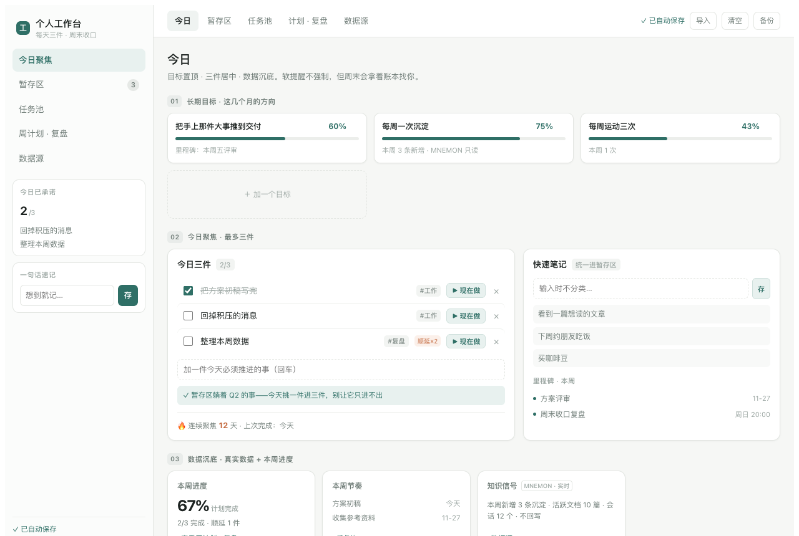
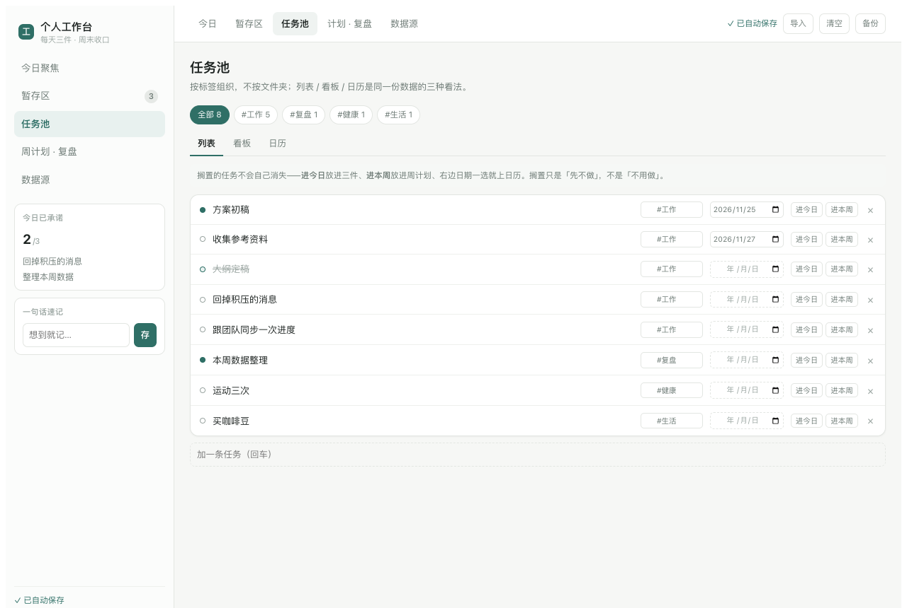
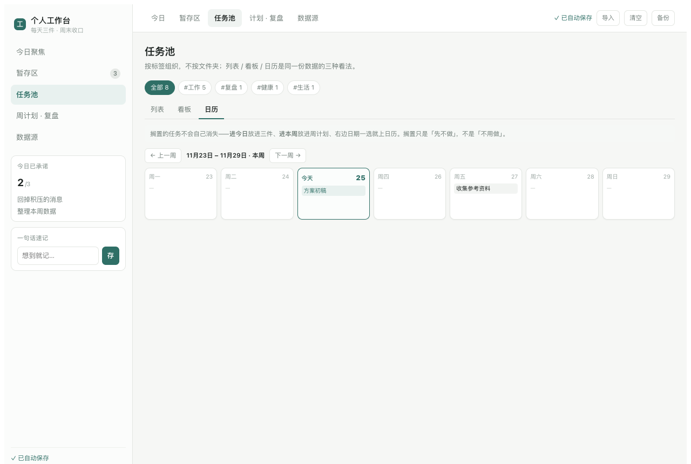

# dsh-workbench · 个人工作台

DeepSeek Harness 插件。每天只锁三件事，想到的东西先丢暂存区，周末对着计划收一次口。



## 它解决什么

大多数待办工具的失败点不在「记不住」，而在「记了不做」和「记了一堆没分类」。这个工作台只做三件事：

1. **今天最多三件**。加第四件时标红提醒，但不拦你——周末复盘会拿着账本找你。
2. **输入时不分类**。想到就记，分类推迟到每天集中分流一次，每条标四象限后转成任务或移到明天。
3. **周初有计划，周末有对照**。顺延次数自动汇总，不用自己数。

## 安装

### 从 GitHub Release 安装（推荐）

1. 打开 DeepSeek Harness，左栏进入 **Plugins**。
2. 点 **Add plugin**，填入 Release 里的 tarball 地址，例如：
   ```
   https://github.com/PLAhui/dsh-workbench/releases/download/v1.1.1/plahui-dsh-workbench-1.1.1.tgz
   ```
3. 安装完成后重启 DeepSeek Harness。

### 从本地目录安装

下载仓库后，在 **Plugins → Add plugin** 里填目录的绝对路径，例如 `/Users/you/code/dsh-workbench`。

## 五个视图

| 视图 | 做什么 |
|---|---|
| 今日 | 长期目标 + 今天三件 + 数据沉底 |
| 暂存区 | 零摩擦缓冲池，输入时不分类 |
| 任务池 | 列表 / 看板 / 日历，同一份数据三种看法；每条可排期、可进今日、可进本周 |
| 周计划 · 复盘 | 周初定三件，周末对照收口 |
| 数据源 | MNEMON 与本机会话的只读快照 |

任务池列表——每条任务带日期框和两个出口：



日历可翻周，排到下个月也看得到：



## 一条任务怎么流动

```
暂存区速记 → 标象限 → 「→任务」进任务池
                              ↓
            任务池里三选一（这是关键的一步）
            ├─ 选日期  → 上日历，按天看到
            ├─ 进今日  → 进今日三件，今天就做
            └─ 进本周  → 进周计划，这周要推进
```

任务池不是仓库，是**分流站**。搁置只是「先不做」，不是「不用做」——所以每条任务都带着这三个出口。

**状态是互通的**：任务进了今日三件或周计划后，在任务池里把它勾完成，那两处会跟着变成已完成；反过来在今日三件里勾掉，任务池那条也会跟着变。带「任务池」小标记的条目就是这种联动条目。

**标签是你自己的分类法**：任务池里每条任务的标签是个输入框，想写什么就写什么（没写 `#` 会自动补上，留空就是无标签）。用过的标签会出现在下拉提示里可以直接点选，也可以无视它写新的。系统不会替你打标签。

## 数据存在哪

**改动自动保存在浏览器本机**，不需要点保存。

- 今日三件、暂存区、任务池、周计划：浏览器 localStorage。
- 数据源快照：插件在 Host 进程内直接读本机文件，只读不回写。

「导入 / 清空 / 备份」三个按钮可以整体搬迁或重置数据。

## 数据源

插件跑在 DSH 的 Host 进程里，直接读本机文件，不起外部服务、不联网：

- **MNEMON**：`~/.mnemon/runtime/memories.json` 与 `~/.mnemon/documents/index.json`
- **DSH 会话**：`~/.dsh/sessions/` 下近 7 天的会话，按工作区聚合

读不到文件时对应卡片显示「未读取」，其余功能不受影响。

## 边界

- 所有数据源都是只读，工作台不回写 MNEMON 或会话。
- 这是一个规则引擎 + 界面，不含任何模型调用。它不会替你判断「这周最重要的一件事」是什么。

## 许可

MIT
